


&nbsp;

<!-- &nbsp; -->

 

  


  

 search author:bladekiller246. Matching modules:">
<a href="https://github.com/Bladekiller246/dvwa-file-upload-Vulnerability-"></a>
<a href="https://github.com/Bladekiller246/DATNet"></a>
<a href="https://github.com/Bladekiller246/SemiCon-ML"></a>

  


<picture>
  <source media="(prefers-color-scheme: dark)" srcset="https://raw.githubusercontent.com/Bladekiller246/Bladekiller246/output/snake-dark.svg">
  <source media="(prefers-color-scheme: light)" srcset="https://raw.githubusercontent.com/Bladekiller246/Bladekiller246/output/snake-light.svg">
  
</picture>

  

